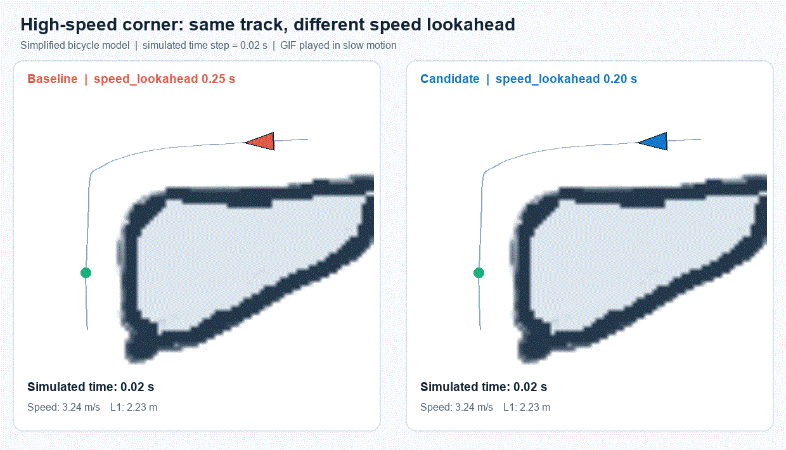

# unita-f1tenth-corner-study

동아리 과제 2번 **"고속 코너에서 차량이 트랙 바깥으로 밀림"**에 대한 파라미터 비교 기록이다.
`speed_lookahead`와 `curvature_factor`를 바꿔 가며 `test1` 트랙의 코너(웨이포인트 365~400)를 비교용 시뮬레이션으로 주행시켰다.



## 구성

| 경로 | 내용 |
|---|---|
| [노션_과제_보고서_고속_코너.md](노션_과제_보고서_고속_코너.md) | 과제 보고서 |
| [고속_코너_주행_파라미터_조사.md](고속_코너_주행_파라미터_조사.md) | 파라미터 사전 조사 |
| [corner_parameter_test.py](corner_parameter_test.py) | 9개 조합을 자동으로 주행시키고 결과를 기록하는 시뮬레이션 |
| [make_corner_gif.py](make_corner_gif.py) | 두 설정의 주행 궤적을 나란히 보여주는 GIF 생성 |
| [corner_test_results/](corner_test_results/) | 속도 배율 0.8 / 0.9 / 1.0 결과 (`results.csv`, 주행 궤적 CSV, 요약 `report.md`) |
| [track_data/](track_data/) | 시뮬레이션이 읽는 `controller.yaml`과 `test1` 경로·지도 (동아리 racing_stack의 `stack_master/config`, `stack_master/maps/test1`에서 복사) |

## 실행

```bash
pip install numpy pillow
python corner_parameter_test.py --speed-scale 0.8
python make_corner_gif.py
```
